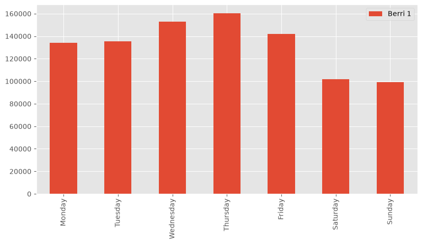
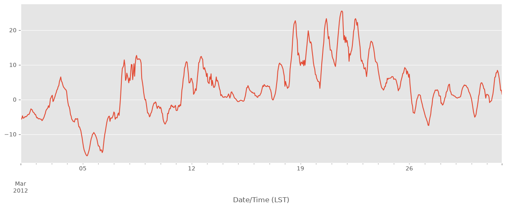
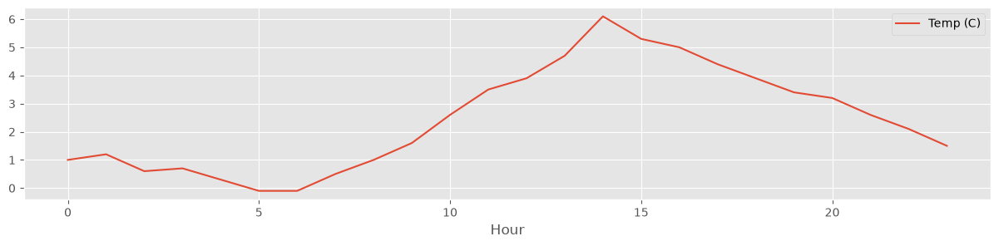
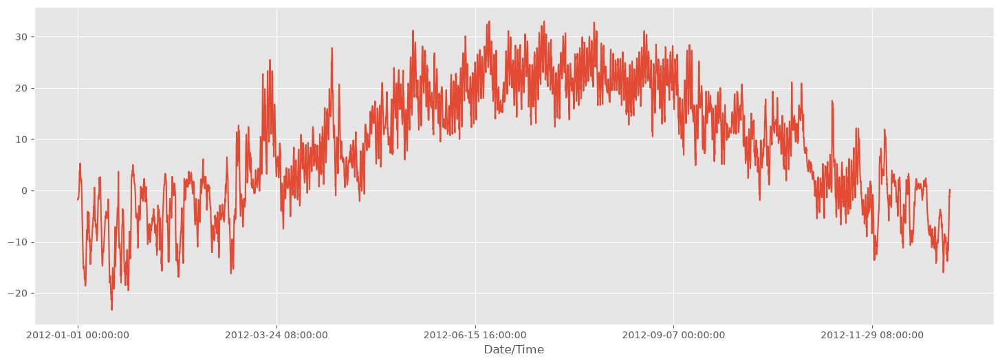

# Лабораторная работа № 3. Группировка и объединение данных

Две задачи: выяснить, в какие дни недели монреальцы больше ездят на велосипеде (группировка),
и собрать погодные данные за весь 2012 год из 12 помесячных выгрузок (объединение нескольких DataFrame).

## Что сделано

### Часть 1. Группировка: велосипедисты по дням недели

1. Загрузил `bikes.csv` (как в лабораторной № 1) и посмотрел, как выглядят данные за один день — `bikes.loc["2012-01-02"]`.
2. Оставил только велодорожку `Berri 1` и добавил столбец `weekday` из `DatetimeIndex` (`index.weekday`, 0 — понедельник).
3. Сгруппировал по дню недели и просуммировал: `groupby('weekday').aggregate(sum)`.
4. Заменил номера дней на названия и построил столбчатую диаграмму.
5. В конце собрал весь пайплайн в одну ячейку — от чтения файла до графика.

### Часть 2. Объединение: погода за 2012 год

1. Загрузил выгрузку с сайта [Environment Canada](https://climate.weather.gc.ca/) за март 2012 года
   (метеостанция Монреаля) напрямую по URL через `pd.read_csv`.
2. Почистил данные:
   - переименовал столбцы, убрав символ градуса `°`;
   - удалил столбцы с пропусками — `dropna(axis=1, how='any')`;
   - удалил служебные столбцы (координаты, название станции, год/месяц/день и т. д.).
3. Посчитал медианную температуру по часам суток за март.
4. Оформил загрузку и очистку в функцию `download_weather_month(year, month)`.
5. Скачал все 12 месяцев и склеил их через `pd.concat` в одну таблицу за год, сохранил в `data/weather_2012_downloaded.csv`.

## Результаты

**Дни недели.** По `Berri 1` больше всего поездок в будни, пик — четверг (160 131),
в выходные примерно на треть меньше (суббота 101 578, воскресенье 99 310). Похоже, велосипед в основном используют,
чтобы добираться на работу или учёбу.

| День | Поездок |
|---|---|
| Понедельник | 134 298 |
| Вторник | 135 305 |
| Среда | 152 972 |
| Четверг | 160 131 |
| Пятница | 141 771 |
| Суббота | 101 578 |
| Воскресенье | 99 310 |



**Погода.** Температура в марте 2012 года сильно скакала — от −15 °C в начале месяца до +25 °C около 20-го числа:



Медианная температура по часам: минимум около 5–6 утра (~0 °C), максимум около 14:00 (~6 °C).



Итоговая таблица за год, склеенная из 12 месяцев:



## Структура

```
├── lab_03.ipynb             # решение
├── data/
│   ├── bikes.csv            # велосипедисты Монреаля, 2012
│   └── weather_2012.csv     # эталонная погода за 2012 год для сравнения
└── images/                  # графики для README
```

Файл `weather_2012_downloaded.csv` создаётся при запуске ноутбука, для загрузки погоды нужен интернет.

## Запуск

```bash
pip install -r requirements.txt
jupyter notebook lab_03.ipynb
```
